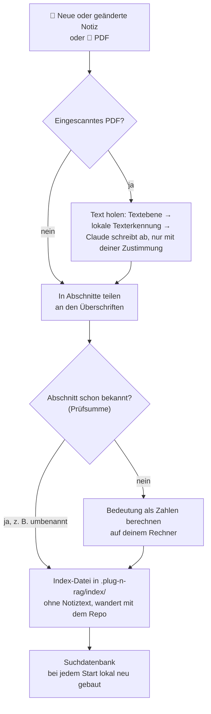
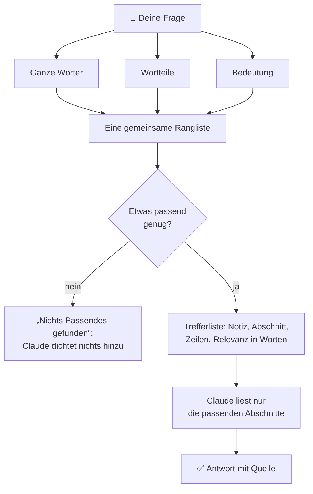

# plug-n-rag

[English](README.md) · **Deutsch**

> **KI-Agenten:** Sollst du ein Repo für plug-n-rag einrichten? Folge [AGENTS.md](AGENTS.md)
> (roh: `https://raw.githubusercontent.com/sign-u-p/plug-n-rag/main/AGENTS.md`).

**Claude kennt deine Notizen und liest nur, was es für deine Frage wirklich braucht.**

plug-n-rag ist eine Erweiterung für [Claude Code](https://code.claude.com). Sie macht deine
Obsidian-Notizen (und auf Wunsch andere Ordner mit Dokumenten) für Claude durchsuchbar. Wenn du
Claude etwas fragst, sucht es zuerst in deinen eigenen Notizen, liest nur die passenden Stellen und
sagt dir, woher eine Aussage stammt.

Gedacht ist plug-n-rag für alle, die mit einer gewachsenen Sammlung arbeiten: Projekt- und
Besprechungsnotizen, Lesenotizen, ein Zettelkasten, Unterlagen aus Studium und Weiterbildung oder
ein Ordner voller Fachbücher als PDF. Programmierkenntnisse brauchst du nicht. plug-n-rag spricht
Deutsch und Englisch; das Suchmodell ist gezielt so gewählt, dass es Deutsch besonders gut kann.

## Was hast du davon?

- **Antworten aus deinem eigenen Wissen, mit Quelle.** Claude nennt bei jeder Aussage die Notiz
  und die Zeilen, aus denen sie stammt. Du kannst alles nachprüfen.
- **Treffer auch bei anderen Worten.** Du fragst nach den „Kosten“ eines Projekts, gefunden wird
  auch die Notiz, in der vom „Budget“ die Rede ist. Und „Datenschutz“ findet auch
  „Datenschutzbeauftragte“ oder „Datenschutzerklärung“.
- **Weniger Verbrauch.** Claude liest nicht mehr ganze Notizen, sondern die zwei, drei passenden
  Abschnitte. Das schont dein Nutzungskontingent (bzw. die Kosten) und lässt mehr Platz für deine
  eigentliche Aufgabe.
- **Ehrliche Antworten.** Steht etwas nicht in deinen Notizen, sagt Claude das, statt etwas
  hinzuzudichten.
- **Deine Notizen bleiben, wie sie sind.** plug-n-rag verändert keine Notiz und schickt ohne deine
  Zustimmung nichts an zusätzliche Dienste.

### So sieht das aus

**In deiner Vault**, zum Beispiel mit Projekt- und Besprechungsnotizen:

> **Du:** Was haben wir beim Website-Relaunch zum Budget entschieden?
>
> **Claude:** Laut deinen Notizen:
> – Im Kick-off wurde ein Rahmen von 12.000 € festgelegt, davon 2.000 € als Reserve
> (besprechungen/2026-09-03 Kick-off Relaunch.md, Z. 14–22).
> – Im Oktober wurde die Reserve für die barrierefreie Umsetzung freigegeben
> (projekte/Website-Relaunch.md › Entscheidungen, Z. 40–47).
> Wer die Freigabe erteilt hat, steht nicht in deinen Notizen.

Gelesen hat Claude dafür zwei kurze Abschnitte statt aller Notizen zum Projekt.

**In einer Bibliothek**, zum Beispiel einem Ordner mit Fachbüchern als PDF:

> **Du:** Was sagen meine Bücher dazu, wie man Feedback-Gespräche vorbereitet?
>
> **Claude:** Zwei deiner Bücher behandeln das:
> – Ziel und Beobachtungen vorher schriftlich festhalten, Bewertungen davon trennen
> (Fuehrung/Gespraechsfuehrung.pdf, S. 45, gedruckt S. 37).
> – Dem Gegenüber vorab ankündigen, worum es geht, damit es sich vorbereiten kann
> (Fuehrung/Teams leiten.pdf, S. 112–113).

Die Zahlen und Inhalte sind ausgedacht; so sehen die Quellenangaben aus.

Was dabei im Hintergrund passiert, zeigen zwei kurze Grafiken: [Auf einen Blick](#auf-einen-blick).

## Deutsch und Englisch

plug-n-rag funktioniert mit deutschen und englischen Notizen gleich gut, auch gemischt in einer
Vault. Das Suchmodell (multilingual-e5-small) wurde gezielt gewählt, weil es deutsche Texte und
Zusammensetzungen wie „Datenschutzbeauftragte“ besonders gut versteht; Englisch beherrscht es
genauso, dazu rund 100 weitere Sprachen. Eine englische Frage findet auch eine deutsche Notiz und
umgekehrt, am zuverlässigsten aber in der Sprache der Notizen.

- **Claude antwortet in deiner Sprache**, egal in welcher die Notizen stehen.
- **Die festen Texte** von plug-n-rag (Suchergebnisse, Status, Übersicht, Anzeige im Chat) folgen
  der Sprache, die bei der Einrichtung gewählt wurde. Umstellen: Claude bitten oder
  `plug-n-rag konfig --setzen language=en` (bzw. `language=de`).
- **Alle Befehle gibt es in beiden Sprachen**, z. B. `plug-n-rag suche` und `plug-n-rag search`,
  `/plug-n-rag:aufnehmen` und `/plug-n-rag:ingest`.

Warum das wichtig ist: plug-n-rag spart Tokens, und damit Rechenleistung und Energie. Das soll
nicht an einer Sprachgrenze enden.

## Begriffe in einer Minute

Du brauchst diese Wörter nicht zu kennen, um plug-n-rag zu nutzen. Sie helfen aber beim Lesen.

| Begriff | Bedeutung |
| --- | --- |
| **Claude Code** | Claude als Arbeitsumgebung auf deinem Rechner (Desktop-App oder Terminal) oder im Browser. Anders als im normalen Chat darf Claude dort mit deinen Dateien arbeiten. |
| **Plugin** | Eine Erweiterung, die Claude Code neue Fähigkeiten gibt. plug-n-rag ist ein Plugin. |
| **Marketplace** | Ein Verzeichnis, aus dem man Plugins installiert. Dieses Repository ist so ein Verzeichnis. |
| **Vault** | Ein Ordner mit Obsidian-Notizen (erkennbar am versteckten Unterordner `.obsidian`). |
| **Sammlung** | Ein anderer Ordner mit Dokumenten (Text, Markdown, PDF), den du durchsuchbar machen willst. |
| **Token** | Die Einheit, in der Claude Text liest und abrechnet, grob vier Buchstaben. Weniger gelesene Tokens heißt: weniger Verbrauch. |
| **Index** | Ein Verzeichnis zum schnellen Finden, wie das Stichwortverzeichnis eines Buchs. plug-n-rag legt einen für deine Notizen an. |
| **Git, GitHub, Repo** | Git speichert Versionen von Dateien, GitHub bewahrt sie online auf. Ein Repo (Repository) ist ein so verwalteter Ordner. Für plug-n-rag optional, aber nötig, wenn du auf mehreren Geräten oder im Browser arbeiten willst. |
| **Cloud-Sitzung** | Claude Code im Browser (claude.ai/code) oder in der Handy-App. Claude arbeitet dann auf einem Rechner von Anthropic mit einer Kopie deines Repos. |

## Loslegen in drei Schritten

### 1. Vorbereiten

- **Claude Code** installieren und anmelden: [Anleitung](https://code.claude.com/docs/de/quickstart).
- **uv** installieren. uv ist ein kleines Hilfsprogramm, das plug-n-rag startet und alles Nötige
  (z. B. Python) selbst mitbringt. Du kannst diesen Punkt auch überspringen: Fehlt uv, bietet
  Claude an, es zu installieren.
  - macOS oder Linux, im Terminal:

    ```bash
    curl -LsSf https://astral.sh/uv/install.sh | sh
    ```

  - Windows, in PowerShell:

    ```bash
    powershell -ExecutionPolicy ByPass -c "irm https://astral.sh/uv/install.ps1 | iex"
    ```

### 2. Installieren

Wähle einen Weg. Am einfachsten ist A.

**A: Über die Plugin-Seite** (Desktop-App oder claude.ai)

1. **Einstellungen → Plugins** öffnen (auf claude.ai: „Anpassen“ → „Plugins“). In der Desktop-App
   öffnet sich diese Seite auch, wenn du `/plugin` eingibst.
2. Oben rechts **Hinzufügen → Marketplace hinzufügen** wählen, `sign-u-p/plug-n-rag` eintragen,
   bestätigen.
3. Bei **plug-n-rag** auf **Hinzufügen** klicken.
4. Fertig. Das Plugin gehört jetzt zu deinem Claude-Konto und ist ab der nächsten Sitzung da (in
   einer offenen Sitzung: `/reload-plugins` eingeben).

**B: Im Terminal**

```bash
claude plugin marketplace add sign-u-p/plug-n-rag
```

```bash
claude plugin install plug-n-rag@plug-n-rag
```

**C: Claude machen lassen.** Eine Sitzung im Ordner deiner Vault öffnen und schreiben: „Richte
dieses Repo für plug-n-rag ein: github.com/sign-u-p/plug-n-rag“. Claude installiert das Plugin und
beginnt gleich mit der Einrichtung (Schritt 3 passiert dann von selbst).

Für den Browser (claude.ai/code) gibt es einen eigenen Weg, siehe [In der Cloud nutzen](#in-der-cloud-nutzen).

### 3. Einrichten

1. Claude Code **im Ordner deiner Vault** öffnen (in der Desktop-App: diesen Ordner als Projekt
   wählen). Claude meldet dann: „Obsidian-Vault erkannt, aber noch nicht eingerichtet.“
2. `/plug-n-rag:setup` eingeben.
3. Claude führt dich in Ruhe durch die Einrichtung und erklärt jeden Schritt. Du entscheidest,
   Claude erledigt:
   - eine Bestandsaufnahme deiner Notizen,
   - einen kurzen Hinweis, welche Daten wohin gehen,
   - die Frage, welche Ordner privat bleiben sollen (z. B. ein Tagebuch),
   - auf Wunsch ein privates Repo auf GitHub, damit es auf mehreren Geräten klappt,
   - eine Schätzung, wie lange das Einrichten dauert und was es kostet (lokal: nichts),
   - das erste Durchsuchbar-Machen, eine Übersicht deiner Vault und eine Probesuche.
4. Beim ersten Start fragt Claude Code eventuell, ob plug-n-rag automatisch mitlaufen darf.
   Bitte erlauben, sonst bleibt die Suche nicht aktuell.

Beim ersten Einrichten lädt plug-n-rag einmalig ein Sprachmodell herunter (etwa 470 MB, je nach
Verbindung ein paar Minuten). Die Suche nach Stichworten funktioniert schon vorher. Jede Suche
nennt in der ersten Zeile ihren Suchmodus („semantisch + Stichwort“ oder „nur Stichwort ·
Suchmodell lädt (60 %)“); solange etwas fehlt, kennzeichnet Claude die Antwort als vorläufig.

### Und dann: einfach fragen

- „Was habe ich mir zum Thema Zeitmanagement notiert?“
- „Fass meine Besprechungsnotizen vom Oktober zusammen. Welche Aufgaben sind noch offen?“
- „Recherchiere in meiner Vault alles, was ich zu Datenschutz in Vereinen gesammelt habe.“
- „Was steht in meinen Fachbüchern zu Nebenkostenabrechnungen?“
- „Schreib mir aus meinen Lesenotizen eine Zusammenfassung für das Team.“

War dir eine Antwort zu knapp oder zu ausführlich, sag es einfach („Das war mir zu oberflächlich“).
plug-n-rag merkt sich das für diese Art von Aufgabe.

## Was du wissen solltest

**Datenschutz in Kürze**

- Was Claude liest, geht an Anthropic, wie bei jeder Nutzung von Claude. Mit plug-n-rag ist das
  in der Regel *weniger* als ohne, weil Claude nur passende Abschnitte liest.
- Die Suche selbst läuft auf deinem Rechner. Ohne deine Zustimmung geht nichts an weitere Dienste.
- Ordner und Notizen, die du als privat markierst, werden nie durchsucht und nie gespeichert.

<details>
<summary>Datenschutz im Detail</summary>

- **Wohin was geht:**

  | Dienst | Was | Wann |
  | --- | --- | --- |
  | Anthropic | die Abschnitte, die Claude liest, und deine Fragen | bei jeder Nutzung von Claude |
  | Anthropic | ganze eingescannte Dokumente zum Abschreiben | nur nach ausdrücklicher Rückfrage |
  | Hugging Face | nichts von dir: von dort wird nur einmal das Sprachmodell heruntergeladen | beim ersten Einrichten |
  | Voyage AI | Notiztexte zum Berechnen der Suchdaten | nur wenn du diesen Dienst ausdrücklich wählst |
  | GitHub | Notizen und Suchindex in **deinem privaten** Repo | nur wenn du ein Repo nutzt |

- **Der Suchindex enthält keinen Notiztext**, aber er bildet Inhalte als Zahlen ab. Behandle ihn
  deshalb so vertraulich wie die Notizen selbst. Ein Repo muss privat sein; Einrichtung und
  Statusanzeige prüfen das und warnen, wenn nicht.
- **Private Bereiche:** Ordner, die du als privat einträgst (`private_folders`), und Notizen mit
  `privat: true` in den Eigenschaften oben in der Notiz (Frontmatter) werden vollständig
  ausgelassen. Wird eine Notiz später privat, entfernt plug-n-rag ihre Suchdaten beim nächsten
  Abgleich.
- **Protokoll:** Damit plug-n-rag mitlernen kann, merkt es sich, welche Notizen gefunden und
  gelesen wurden (Pfade und Zahlen), aber nie deine Fragen und nie Notizinhalte. Das Protokoll
  bleibt auf deinem Rechner.
- **Schlüssel für Voyage AI** gehören nur in die Umgebungsvariable `VOYAGE_API_KEY` (in der Cloud
  in ein „Netzwerk-Secret“), nie in eine Datei im Repo.

</details>

**Kosten:** Mit dem lokalen Sprachmodell kostet plug-n-rag nichts außer deinem normalen
Claude-Verbrauch, und den senkt es. Der optionale Dienst Voyage AI rechnet nach Textmenge ab;
Claude nennt dir den aktuellen Preis vorher.

**Was plug-n-rag anlegt:**

| Was | Wo |
| --- | --- |
| Einstellungen und Suchindex (auf Wunsch auch Abschriften) | ein Ordner `.plug-n-rag/` in deiner Vault. Obsidian blendet ihn aus. |
| Arbeitsdateien (die eigentliche Suchdatenbank, Protokoll, Zwischenstände) | im Zwischenspeicher deines Benutzerkontos, nie in der Vault, nie online |
| Abschriften von PDFs | als normale Notizen, neben dem PDF oder in einem Ordner „Abschriften/“ (du wählst) |

plug-n-rag wieder loswerden: Plugin deinstallieren und den Ordner `.plug-n-rag/` löschen.

## Wie plug-n-rag funktioniert

Für alle, die es genau wissen wollen. Zum Benutzen ist nichts davon nötig. Erst der Überblick,
dann die Einzelheiten; jeder Abschnitt dort lässt sich aufklappen.

### Auf einen Blick

**Wenn neue Informationen dazukommen** (eine neue oder geänderte Notiz, ein PDF):



plug-n-rag teilt die Notiz in Abschnitte, berechnet nur, was neu ist, und legt das Ergebnis neben
deinen Notizen ab. Die Notizen selbst bleiben unverändert.

**Wenn du etwas fragst:**



Drei Suchen laufen gleichzeitig und werden zu einer Rangliste zusammengeführt. Claude sieht zuerst
eine kurze Liste und liest dann nur die Stellen, die es braucht. Dort entsteht die Ersparnis.

### Im Detail

<details>
<summary><b>1. Notizen in Abschnitte zerlegen</b></summary>

plug-n-rag teilt jede Notiz an ihren Überschriften in Abschnitte. Sehr lange Abschnitte werden
zusätzlich an Absätzen geteilt (Richtwert: etwa 500 Tokens, mit etwas Überlappung, damit kein
Gedanke an einer Schnittstelle verloren geht). Jeder Abschnitt kennt seinen Ort in der Notiz,
z. B. „Website-Relaunch › Entscheidungen“, und seine Zeilen. PDFs werden nach Seiten geteilt, damit Quellen
immer eine genaue Seite nennen.

Eigenschaften oben in der Notiz (Frontmatter), Tags und Verknüpfungen (`[[…]]`) werden nicht
mitgesucht, sondern als Zusatzinformation gespeichert, z. B. für die Frage „Was ist mit dieser
Notiz verknüpft?“.
</details>

<details>
<summary><b>2. Bedeutung als Zahlen: der „Fingerabdruck“ eines Abschnitts</b></summary>

Damit Claude auch bei anderen Worten fündig wird, berechnet ein **Sprachmodell** für jeden
Abschnitt eine Reihe von 384 Zahlen, eine Art Fingerabdruck seiner Bedeutung (Fachbegriff:
*Embedding*). Abschnitte mit ähnlicher Bedeutung bekommen ähnliche Zahlenreihen, egal mit welchen
Worten sie formuliert sind. Bei einer Frage berechnet plug-n-rag denselben Fingerabdruck für die
Frage und sucht die ähnlichsten Abschnitte.

Standardmäßig rechnet das Modell **auf deinem Rechner** („multilingual-e5-small“, gut für Deutsch,
einmalig etwa 470 MB; Englisch und rund 100 weitere Sprachen versteht es
ebenso). Es ist auf eine feste Version festgelegt, damit sich Ergebnisse nie unbemerkt ändern.
Wer will, kann stattdessen den Dienst Voyage AI nutzen: schneller auf schwachen Rechnern, kostet
aber und schickt Texte dorthin.

Aus den Zahlen lässt sich der Text nicht einfach zurückgewinnen, aber sie verraten, worum es
ungefähr geht. Deshalb gelten sie als vertraulich.
</details>

<details>
<summary><b>3. Drei Suchwege, eine Rangliste</b></summary>

Jede Suche läuft auf drei Wegen gleichzeitig:

1. **ganze Wörter**, wie eine klassische Stichwortsuche,
2. **Wortteile**, damit „Datenschutz“ auch „Datenschutzbeauftragte“ findet; das ist für deutsche
   Zusammensetzungen wichtig,
3. **Bedeutung**, über die Fingerabdrücke aus Schritt 2.

Die drei Ranglisten werden zu einer zusammengeführt: Ein Abschnitt, der auf mehreren Wegen weit
oben steht, landet ganz oben (Fachbegriff: *Reciprocal Rank Fusion*). Lange, seltene Wörter aus
deiner Frage zählen dabei mehr als häufige. Literaturverzeichnisse werden abgewertet, weil sie
viele Fachwörter enthalten, aber selten die Antwort.

Dann entscheidet plug-n-rag, **wie viele** Treffer es zeigt: Es schneidet dort ab, wo die
Relevanz deutlich abfällt, statt immer eine feste Zahl zu liefern. Liegt nichts über einer
Mindestschwelle, lautet das Ergebnis „Nichts Passendes gefunden“, und Claude soll dann nicht so
tun, als stünde es in deinen Notizen.

Die Relevanz zeigt plug-n-rag in Worten an („sehr passend“, „passend“, „am Rande“), nicht als
Zahl.
</details>

<details>
<summary><b>4. Stufenweise lesen: so entsteht die Ersparnis</b></summary>

Claude geht vor wie bei einer guten Recherche:

1. **Überblick:** Beim Start bekommt Claude eine Kurzübersicht deiner Vault (Bereiche, Anzahl).
2. **Suche:** Eine Trefferliste nennt Notiz, Abschnitt, Zeilen und Relevanz, aber noch keinen
   ganzen Text.
3. **Gliederung:** Bei langen Notizen schaut Claude zuerst die Überschriften an.
4. **Abschnitt lesen:** Erst jetzt liest Claude genau die passenden Stellen.

Ganze Notizen liest Claude nur, wenn der Zusammenhang wirklich nötig ist, etwa wenn du einen Text
aus deinen Notizen schreiben lässt. Die Ersparnis schätzt plug-n-rag laufend: gelesene Tokens im
Vergleich dazu, was das vollständige Lesen aller Trefferdateien gekostet hätte.
`/plug-n-rag:status` zeigt sie an.
</details>

<details>
<summary><b>5. Immer aktuell, ohne dass du etwas tun musst</b></summary>

plug-n-rag läuft an zwei Stellen automatisch mit:

- **Beim Start jeder Sitzung:** neuesten Stand holen (falls du ein Repo nutzt), Notizen abgleichen,
  Suchdatenbank aufbauen, Claude die Kurzübersicht geben. Das dauert meist wenige Sekunden; was
  länger dauern würde, läuft im Hintergrund weiter.
- **Nach jeder Antwort von Claude:** ein kurzer Abgleich im Hintergrund, falls sich etwas geändert
  hat, auch wenn du zwischendurch in Obsidian geschrieben hast.

Der Abgleich erkennt Änderungen über eine Prüfsumme (einen eindeutigen Kennwert pro Datei). Nur
neue oder geänderte Abschnitte werden neu berechnet. Benennst du eine Notiz um oder verschiebst sie,
erkennt plug-n-rag die Abschnitte wieder und rechnet gar nichts neu. Gelöschte Notizen verschwinden
aus der Suche.

In einem Projekt ohne Vault tut plug-n-rag nichts: Es prüft in wenigen Millisekunden, ob eine Vault
da ist, und beendet sich sonst sofort.
</details>

<details>
<summary><b>6. Warum der Suchindex in deiner Vault liegt</b></summary>

Die Fingerabdrücke zu berechnen kostet Zeit (und mit Voyage AI Geld). Deshalb speichert
plug-n-rag sie als kleine Dateien in `.plug-n-rag/index/`, eine pro Notiz, ohne Notiztext. Liegt
deine Vault in einem Repo, wandern sie mit: Auf einem zweiten Rechner oder in einer Cloud-Sitzung
ist alles sofort suchbereit, ohne neu zu rechnen.

Die eigentliche Suchdatenbank (SQLite mit Volltext- und Vektorsuche) baut plug-n-rag dagegen bei
jedem Start aus diesen Dateien und deinen Notizen neu auf, auf deinem Rechner. Sie wird nie
hochgeladen und nie synchronisiert. Es gibt keinen Server und keine Datenbank im Internet.
</details>

<details>
<summary><b>7. Mitlernen, mit Leitplanken</b></summary>

Claude gibt bei jeder Suche an, wofür es sucht: eine **Frage** (wenige, präzise Treffer), eine
**Recherche** (mehr Breite) oder etwas zu **erstellen** (wenige Notizen, dafür vollständiger).
plug-n-rag beobachtet, wie tief Claude danach liest, und passt langsam an, wie viele Treffer eine
Suche liefert: höchstens einen Schritt pro Sitzung und immer innerhalb fester Grenzen. Deine eigenen
Rückmeldungen („zu oberflächlich“) haben Vorrang. Zurücksetzen geht mit
`/plug-n-rag:lernen-zuruecksetzen`.
</details>

<details>
<summary><b>8. PDFs und eingescannte Seiten</b></summary>

`/plug-n-rag:aufnehmen` holt den Text aus PDFs, Seite für Seite, und versucht dabei nacheinander:

1. den eingebetteten Text des PDFs (kostenlos, exakt),
2. eine Texterkennung auf deinem Rechner (Tesseract, falls installiert),
3. eine Qualitätsprüfung (wie sicher war die Erkennung, wie viele echte Wörter),
4. nur wenn das nicht reicht und **du zustimmst**: Claude liest die Seitenbilder und schreibt sie
   wortgetreu ab, mit dem günstigen Modell Haiku, bei Handschrift auf Wunsch mit Sonnet.

Das Ergebnis wird eine neue Notiz (Vault) oder eine lesbare Abschrift in `.plug-n-rag/abschriften/`
(Sammlung). Bestehende Dateien werden nie überschrieben. Gedruckte Seitenzahlen erkennt plug-n-rag,
wenn möglich, und gibt sie bei Quellen mit an.
</details>

## Weitere Möglichkeiten

### Sehen, was plug-n-rag tut

Der Zusatz **plug-n-rag Display** zeigt im Chat eine ruhige Zeile pro Schritt (z. B. „Gesucht:
3 Notizen · beste sehr passend“), die du aufklappen kannst. Ein schmales Band über dem Eingabefeld
erscheint nur, wenn im Hintergrund gearbeitet wird oder etwas auf dich wartet. Auf Wunsch (`/pnr`)
gibt es eine Seitenleiste mit Verlauf, Zustand und geschätzter Ersparnis. Claude sieht davon
nichts, es kostet also nichts.

```
/plugin install plug-n-rag-anzeige@plug-n-rag
```

Das funktioniert in der Desktop-App, im Terminal und in VS Code, in der Handy-App als eine ruhige
Zeile. Mehr dazu: [plugins/plug-n-rag-anzeige/README.md](plugins/plug-n-rag-anzeige/README.md).

### Andere Ordner durchsuchbar machen

Das eignet sich für Bibliotheken mit Fachbüchern, Seminar- und Kursunterlagen, Vertragsordner
oder Projektablagen. Sag Claude zum Beispiel: „Mach meinen Ordner Fachliteratur durchsuchbar“.
Das geht mit Markdown, Text und PDFs, deren Text sich markieren lässt. Deine Dateien werden nie verändert. Claude fragt
dich, wo plug-n-rag seine eigenen Dateien ablegen soll:

- **im Ordner** (Unterordner `.plug-n-rag`): gut, wenn du den Ordner teilst oder synchronisierst,
  z. B. über Nextcloud oder ein Netzlaufwerk; der Index wandert dann mit,
- **zentral auf deinem Rechner:** im Ordner ändert sich gar nichts.

### In der Cloud nutzen

Mit einer Vault in einem privaten GitHub-Repo funktioniert plug-n-rag auch in Cloud-Sitzungen
(Browser, Handy-App). Das lässt sich sogar komplett dort einrichten: Starte unter claude.ai/code
eine Sitzung mit deinem Vault-Repo und schreib:

```text
Richte dieses Repo für plug-n-rag ein: github.com/sign-u-p/plug-n-rag
```

Mehr braucht es nicht. Alles Weitere findet Claude in diesem Repository ([AGENTS.md](AGENTS.md)):
Es installiert das Plugin für diese Sitzung, führt dich durch die Einrichtung und bindet am Ende
die Selbst-Einrichtung ein, damit künftige Cloud-Sitzungen plug-n-rag von selbst haben. Derselbe
Satz funktioniert auch in einer Sitzung auf deinem Rechner.

Warum nicht gleich `/plug-n-rag:setup`? Plugins, die du über die Plugin-Seite hinzufügst, kommen
(noch) nicht in Cloud-Sitzungen an. Dort kennt Claude den Befehl erst, wenn es das Plugin
installiert hat.

**Nur einmal nötig: die Selbst-Einrichtung.** Claude legt dabei ein kleines Start-Skript in deine
Vault (`.plug-n-rag/cloud-start.sh`). Startet künftig eine Cloud-Sitzung mit deinem Vault-Repo,
installiert dieses Skript plug-n-rag von selbst, in jeder Cloud-Umgebung. Auf deinem Rechner tut
es nichts. Zwei Dinge sind gut zu wissen:

- Die Befehle `/plug-n-rag:…` erscheinen in so einer Sitzung erst, wenn du einmal
  **`/reload-plugins`** eingibst. Bis dahin arbeitet Claude mit denselben Anleitungen direkt
  weiter, du kannst also auch einfach fragen.
- Für die Suche nach Bedeutung (nicht nur nach Stichworten) braucht die **Cloud-Umgebung** (die
  Einstellungen des Rechners, auf dem Claude in der Cloud arbeitet) eine Freigabe für den
  Modell-Download. Claude schlägt sie vor oder erklärt, wo du sie einträgst (`/plug-n-rag:cloud`).

Wieder entfernen: `plug-n-rag cloud --ausbinden`.

<details>
<summary>Cloud-Umgebung von Hand einrichten (Freigabe, optional Setup-Skript)</summary>

Das Setup-Skript ist mit der Selbst-Einrichtung optional. Es lohnt sich trotzdem: Sitzungen in
dieser Umgebung starten dann mit fertig geladenem Modell und allen `/plug-n-rag:…`-Befehlen, ganz
ohne `/reload-plugins`.

1. In der Sitzungsleiste auf den Namen der Cloud-Umgebung tippen, „Bearbeiten“ (oder eine eigene
   Umgebung „Hinzufügen“, z. B. „Vault“).
2. **Network access:** „Limited“, „Allow package managers“ angehakt lassen. Unter
   **Allowed domains** eintragen:

   ```text
   huggingface.co
   *.hf.co
   ```

3. **Setup script** einfügen:

   ```bash
   #!/bin/bash
   command -v claude >/dev/null 2>&1 || exit 0
   claude plugin marketplace add sign-u-p/plug-n-rag >/dev/null 2>&1 \
     || claude plugin marketplace update plug-n-rag >/dev/null 2>&1 || true
   claude plugin install plug-n-rag@plug-n-rag >/dev/null 2>&1 || true
   P=$(ls -d "$HOME"/.claude/plugins/cache/plug-n-rag/plug-n-rag/*/ 2>/dev/null | sort -V | tail -1)
   [ -n "$P" ] || echo "plug-n-rag: Installation fehlgeschlagen (ist github.com/sign-u-p/plug-n-rag erreichbar?)" >&2
   if [ -n "$P" ]; then "${P}scripts/plug-n-rag" modell-laden --modell intfloat/multilingual-e5-small || true; fi
   exit 0
   ```

4. Speichern und eine neue Sitzung mit dem Vault-Repo in dieser Umgebung starten. Der erste Start
   dauert einige Minuten (Modell-Download). Danach speichert die Cloud die fertige Umgebung, und
   neue Sitzungen sind sofort suchbereit.
5. Prüfen: Claude bitten, `plug-n-rag cloud --pruefen` auszuführen.

Gut zu wissen:
- Der Suchindex (`.plug-n-rag/index/`) muss im Repo liegen, sonst rechnet jede Cloud-Sitzung neu.
- Mit Voyage AI statt lokalem Modell entfällt die Freigabe für Hugging Face. Den Voyage-Schlüssel
  trägst du als **Netzwerk-Secret** der Umgebung für `api.voyageai.com` ein.
- Neue Versionen von plug-n-rag kommen in die Cloud-Umgebung, wenn sie neu gebaut wird (spätestens
  nach etwa sieben Tagen oder nach einer Änderung am Skript).

</details>

### Änderungen aus dem Chat übernehmen („nach main“)

Cloud-Sitzungen arbeiten auf einem eigenen Arbeitszweig (Branch) deines Repos. Was Claude dort an
Notizen ändert, landet erst im Hauptstand (`main`), wenn du es übernimmst. Das geht direkt aus
dem Chat: Sag „leg das nach main“ (oder `/plug-n-rag:nach-main`). Danach siehst du die Änderungen
auch in Obsidian.

Dabei wird nichts überschrieben: Hat sich der Hauptstand inzwischen geändert (z. B. durch Obsidian
auf deinem Rechner), wird zuerst zusammengeführt. Haben du und Claude **dieselbe Notiz** verschieden
geändert, fragt Claude dich, welche Fassung gelten soll. Sieht etwas wie ein geheimer Schlüssel
aus, wird gar nichts übernommen.

## Nachschlagen

### Befehle

| Befehl | Wofür |
| --- | --- |
| `/plug-n-rag:setup` | geführte Einrichtung (auch zum Fortsetzen oder Prüfen) |
| `/plug-n-rag:status` | Ist alles aktuell? Gibt es Fehler? Wie viel wurde gespart? Gibt es eine neuere Version? |
| `/plug-n-rag:aufnehmen` (`ingest`) | PDFs und eingescannte Dokumente in durchsuchbaren Text umwandeln |
| `/plug-n-rag:cloud` | Nutzung in Cloud-Sitzungen einrichten und prüfen |
| `/plug-n-rag:nach-main` (`to-main`) | Änderungen aus dem Chat in den Hauptstand des Repos übernehmen |
| `/plug-n-rag:reindex` | alles neu berechnen, z. B. nach einem Modellwechsel |
| `/plug-n-rag:modell-wechseln` (`switch-model`) | lokales Modell oder Voyage AI wählen |
| `/plug-n-rag:lernen-zuruecksetzen` (`reset-learning`) | gelernte Suchgewohnheiten zurücksetzen |

Im Hintergrund benutzt Claude die Werkzeuge `plug-n-rag suche`, `gliederung`, `lesen`,
`verwandt` und `karte` (englisch `search`, `outline`, `read`, `related`, `map`). Für Fragen
nach dem zeitlichen Ablauf („Was passierte danach?“) listet `plug-n-rag suche --in <ordner>
--chronologisch --seit JJJJ-MM-TT` Notizen nach ihrem Datum (aus Dateiname oder Frontmatter,
Wochennotizen wie `2024-W07` eingeschlossen); `verwandt` nennt bei datierten Notizen den Tag
davor und danach und die passende Wochennotiz. Du kannst sie auch selbst im Terminal aufrufen (`plug-n-rag --help`).

<details>
<summary>Einstellungen (<code>.plug-n-rag/plug-n-rag.yml</code>)</summary>

Am bequemsten änderst du Einstellungen, indem du Claude darum bittest. Die wichtigsten:

| Einstellung | Bedeutung | Standard |
| --- | --- | --- |
| `language` | Sprache der festen Texte (`de`, `en`); fehlt sie in einer älteren Konfiguration, gilt Deutsch | bei der Einrichtung gewählt |
| `embedding.provider`, `embedding.model` | welches Sprachmodell die Fingerabdrücke berechnet (`local` oder `voyage`) | `local`, `intfloat/multilingual-e5-small` |
| `private_folders` | Ordner, die nie durchsucht werden, z. B. `["Tagebuch/**"]` | leer |
| `exclude` | weitere ausgeschlossene Ordner (z. B. Vorlagen) | Systemordner, erkannte Vorlagen |
| `folders` | kurze Beschreibung je Ordner für die Übersicht | leer |
| `formats` | welche Dateitypen gelesen werden (`markdown`, `text`, `pdf`) | Vault: `markdown` |
| `abschriften.ort` | wohin Abschriften von PDFs kommen | wird beim ersten Mal gefragt |
| `transcription` | ob vor dem Abschreiben gefragt wird (`ask`, `allow`, `local_only`) | `ask` |
| `anzeige` | Quellenzeile in Cloud-Sitzungen (`kompakt`, `aus`) | `kompakt` |
| `updates` | neuere plug-n-rag-Version beim Sitzungsstart: Claude fragt (`fragen`), aktualisiert selbst (`automatisch`) oder schweigt (`aus`) | `fragen` |
| `tuning.commit_learning` | Gelerntes mit ins Repo legen (sonst nur lokal) | `false` |
| `git.auto_commit`, `git.auto_push` | Änderungen beim Start automatisch sichern bzw. hochladen | aus |

</details>

<details>
<summary>Von einer älteren Version umsteigen</summary>

Bis Version 0.5 lagen die Einstellungen in `plug-n-rag.yml` im Hauptordner und Arbeitsdateien in
`.plug-n-rag/cache`. Das funktioniert weiter. Beim Start weist plug-n-rag auf den aufgeräumten
Aufbau hin; `plug-n-rag umziehen` (oder Claude darum bitten) stellt um, ohne etwas neu zu
berechnen. Bereits abgeschriebene Seiten bleiben erhalten.

</details>

<details>
<summary>Für Fortgeschrittene: MCP-Server</summary>

plug-n-rag bringt die Suchwerkzeuge auch als MCP-Server mit (eine Standard-Schnittstelle, über die
Claude Werkzeuge anderer Programme nutzt). Er ist nicht automatisch aktiv. Nach der ersten Sitzung
mit plug-n-rag lässt er sich so anmelden:

```bash
claude mcp add plug-n-rag -- ~/.cache/plug-n-rag/plug-n-rag mcp
```

</details>

## Bekannte Grenzen

- Gelesen werden Markdown, Text und PDFs mit markierbarem Text. Word, HTML und E-Books folgen.
- Die Texterkennung für eingescannte Seiten auf deinem Rechner braucht das Programm Tesseract
  (Claude bietet die Installation an). Ohne Tesseract bleibt das Abschreiben durch Claude, nur nach
  Rückfrage.
- Der einmalige Modell-Download ist mit etwa 470 MB groß.
- Wie streng „passend“ ist, ist an einer kleinen Beispiel-Vault eingestellt und wird mit echten
  Vaults nachjustiert. Rückmeldungen helfen.
- Unter Windows wird Git Bash benötigt (kommt mit „Git für Windows“).
- Mehrere Sammlungen lassen sich noch nicht gemeinsam durchsuchen.
- Obsidian Git ist auf dem Handy eingeschränkt. Empfehlung: Obsidian Sync für die Geräte, Git nur
  auf dem Rechner.

## Wenn etwas hakt

| Was du siehst | Was hilft |
| --- | --- |
| „uv fehlt“ beim Start | Schritt 1 oben, oder Claude die Installation erledigen lassen |
| Neue Notizen werden nicht gefunden | `/plug-n-rag:status` zeigt, ob noch etwas aussteht |
| „Suchmodus: nur Stichwort“ oder „Vorläufiges Ergebnis“ | Das Sprachmodell lädt noch, ist nicht da oder passt nicht; `/plug-n-rag:status` erklärt, warum und seit wann die semantische Suche bereit ist. Claude kann mit `--warten` suchen, bis alles bereit ist |
| „Neue Version von plug-n-rag verfügbar“ | Claude fragt, ob aktualisiert werden soll; `plug-n-rag aktualisieren` erledigt es über Claude Code (gilt nach `/reload-plugins`), `--spaeter` überspringt diese Version |
| In der Cloud fehlt plug-n-rag | Die Sitzung läuft in einer anderen Umgebung, oder das Setup-Skript fehlt (`/plug-n-rag:cloud`) |
| Eingescannte PDFs „warten auf Aufnahme“ | `/plug-n-rag:aufnehmen` |
| Die Plugin-Seite zeigt eine alte Beschreibung, oder plug-n-rag Display fehlt | die App kennt noch einen alten Katalog: `claude plugin marketplace update plug-n-rag` ausführen, oder auf der Plugin-Seite den Marketplace entfernen und `sign-u-p/plug-n-rag` neu hinzufügen |

Weitere Hintergründe: [DECISIONS.md](DECISIONS.md) (warum etwas so gebaut ist),
[OPEN.md](OPEN.md) (offene Punkte), [SPEC.md](SPEC.md) (ursprüngliche Spezifikation).

## Für Entwickler:innen

Dieses Repository ist ein Marketplace mit mehreren Plugins, jedes in einem eigenen Ordner:

```
.claude-plugin/marketplace.json   Katalog: plug-n-rag und plug-n-rag-anzeige
plugins/plug-n-rag/               das Hauptplugin
  .claude-plugin/plugin.json
  scripts/plug-n-rag              Starter (uv, Umgebung im Nutzer-Cache; der Sitzungsstart legt ihn auf den PATH)
  hooks/hooks.json                automatische Abläufe beim Start und nach jeder Antwort
  skills/                         suche, setup, cloud, nach-main, status, reindex, aufnehmen, modell-wechseln, lernen-zuruecksetzen,
                                  englische Namen: ingest, to-main, switch-model, reset-learning
  agents/                         transkription (Haiku)
  src/plug_n_rag/                 Python-Kern (i18n.py: Deutsch/Englisch)
  tests/                          pytest, Beispiel-Vault, PDF-Generator
plugins/plug-n-rag-anzeige/       optionaler Mod: Anzeige im Chat (TypeScript)
tools/check.sh                    prüft Katalog und alle Plugins
```

Alles prüfen:

```bash
tools/check.sh --schnell
```

Ohne `--schnell` laufen auch die Tests mit dem echten Sprachmodell (einmalig etwa 470 MB).
Tests gegen Voyage AI laufen nur mit gesetztem `VOYAGE_API_KEY`. Wie ein weiteres Plugin dazukommt,
steht in [CONTRIBUTING.md](CONTRIBUTING.md).

Lizenz: MIT. Übernommene Ideen und ihre Lizenzen: [THIRD_PARTY_NOTICES.md](THIRD_PARTY_NOTICES.md).
