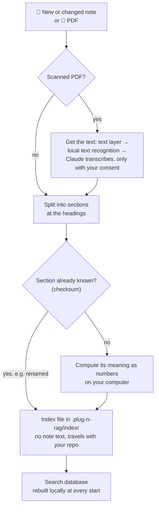
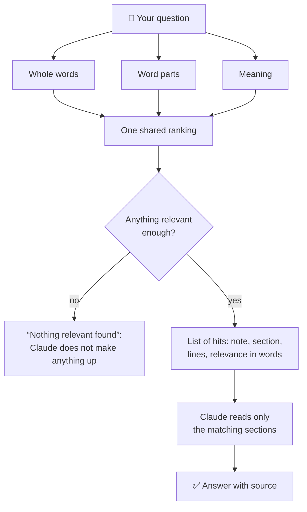

# plug-n-rag

**English** · [Deutsch](README.de.md)

**Claude knows your notes and reads only what it really needs for your question.**

plug-n-rag is an extension for [Claude Code](https://code.claude.com). It makes your Obsidian
notes (and, if you like, other folders full of documents) searchable for Claude. When you ask
Claude something, it first looks in your own notes, reads only the matching passages and tells you
where each statement comes from.

plug-n-rag is meant for anyone who works with a collection that has grown over time: project and
meeting notes, reading notes, a Zettelkasten, material from studies and training, or a folder of
reference books as PDFs. You don't need to know how to program. plug-n-rag speaks English and
German.

## What's in it for you?

- **Answers from your own knowledge, with sources.** For every statement Claude names the note and
  the lines it comes from. You can check everything.
- **Hits even when the words differ.** You ask about the "cost" of a project and also get the note
  that talks about the "budget".
- **Fewer tokens.** Claude no longer reads whole notes, just the two or three matching sections.
  That spares your usage limits (or costs) and leaves more room for the actual task. Fewer tokens
  also means less computing power and energy.
- **Honest answers.** If something isn't in your notes, Claude says so instead of making it up.
- **Your notes stay as they are.** plug-n-rag never changes a note and sends nothing to additional
  services without your consent.

### What it looks like

**In your vault**, for example with project and meeting notes:

> **You:** What did we decide about the budget for the website relaunch?
>
> **Claude:** According to your notes:
> – At the kick-off a frame of €12,000 was set, €2,000 of it as a reserve
> (meetings/2026-09-03 Kick-off relaunch.md, l. 14–22).
> – In October the reserve was released for the accessible implementation
> (projects/Website relaunch.md › Decisions, l. 40–47).
> Who gave the approval is not in your notes.

Claude read two short sections for this instead of every note about the project.

**In a library**, for example a folder of reference books as PDFs:

> **You:** What do my books say about preparing feedback conversations?
>
> **Claude:** Two of your books cover this:
> – Write down the goal and your observations beforehand, and keep judgements separate
> (Leadership/Conversations.pdf, p. 45, printed p. 37).
> – Tell the other person in advance what it will be about, so they can prepare
> (Leadership/Leading teams.pdf, p. 112–113).

The figures and contents are made up; this is what the source references look like.

What happens in the background is shown in two short diagrams: [At a glance](#at-a-glance).

## English and German

plug-n-rag works equally well with English and German notes, even mixed in one vault. The search
model (multilingual-e5-small) was chosen on purpose because it handles German texts and compounds
such as "Datenschutzbeauftragte" especially well, but it handles English just as well, plus about
100 other languages. An English question can also find a German note and vice versa; it is most
reliable in the language of the notes.

- **Claude answers in your language**, whatever language the notes are in.
- **plug-n-rag's fixed texts** (search results, status, overview, the display in the chat) follow
  the language chosen during setup. To switch: ask Claude, or run
  `plug-n-rag config --set language=de` (or `language=en`).
- **Every command exists in both languages**, e.g. `plug-n-rag search` and `plug-n-rag suche`,
  `/plug-n-rag:ingest` and `/plug-n-rag:aufnehmen`.

Why this matters: plug-n-rag saves tokens, and with them computing power and energy. That should
not stop at a language border.

## Terms in one minute

You don't need to know these words to use plug-n-rag, but they help when reading on.

| Term | Meaning |
| --- | --- |
| **Claude Code** | Claude as a workspace on your computer (desktop app or terminal) or in the browser. Unlike the normal chat, Claude may work with your files there. |
| **Plugin** | An extension that gives Claude Code new abilities. plug-n-rag is a plugin. |
| **Marketplace** | A directory you install plugins from. This repository is such a directory. |
| **Vault** | A folder of Obsidian notes (recognisable by the hidden subfolder `.obsidian`). |
| **Collection** | Any other folder of documents (text, Markdown, PDF) you want to make searchable. |
| **Token** | The unit in which Claude reads and bills text, roughly four letters. Fewer tokens read means less usage. |
| **Index** | A directory for finding things quickly, like the index of a book. plug-n-rag builds one for your notes. |
| **Git, GitHub, repo** | Git stores versions of files, GitHub keeps them online. A repo (repository) is a folder managed this way. Optional for plug-n-rag, but needed if you want to work on several devices or in the browser. |
| **Cloud session** | Claude Code in the browser (claude.ai/code) or in the mobile app. Claude then works on a computer run by Anthropic, with a copy of your repo. |

## Get started in three steps

### 1. Prepare

- Install **Claude Code** and sign in: [guide](https://code.claude.com/docs/en/quickstart).
- Install **uv**. uv is a small helper that starts plug-n-rag and brings everything it needs
  (such as Python) by itself. You can also skip this: if uv is missing, Claude offers to install it.
  - macOS or Linux, in the terminal:

    ```bash
    curl -LsSf https://astral.sh/uv/install.sh | sh
    ```

  - Windows, in PowerShell:

    ```bash
    powershell -ExecutionPolicy ByPass -c "irm https://astral.sh/uv/install.ps1 | iex"
    ```

### 2. Install

Pick one way. A is the easiest.

**A: Through the plugin page** (desktop app or claude.ai)

1. Open **Settings → Plugins** (on claude.ai: "Customize" → "Plugins"). In the desktop app this
   page also opens when you type `/plugin`.
2. Top right, choose **Add → Add marketplace**, enter `sign-u-p/plug-n-rag` and confirm.
3. Click **Add** next to **plug-n-rag**.
4. Done. The plugin now belongs to your Claude account and is there from the next session (in an
   open session: type `/reload-plugins`).

**B: In the terminal**

```bash
claude plugin marketplace add sign-u-p/plug-n-rag
```

```bash
claude plugin install plug-n-rag@plug-n-rag
```

**C: Let Claude do it.** Write in a session: "Please run
`claude plugin marketplace add sign-u-p/plug-n-rag` and
`claude plugin install plug-n-rag@plug-n-rag`." Then type `/reload-plugins`.

For the browser (claude.ai/code) there is a way of its own, see [Use it in the cloud](#use-it-in-the-cloud).

### 3. Set up

1. Open Claude Code **in your vault's folder** (in the desktop app: choose this folder as the
   project). Claude then reports: "Obsidian vault detected, but not set up yet."
2. Type `/plug-n-rag:setup`.
3. Claude calmly walks you through the setup and explains each step. You decide, Claude does the
   work:
   - an inventory of your notes,
   - a short note on which data goes where,
   - the question which folders stay private (e.g. a journal),
   - if you like, a private repo on GitHub so it works on several devices,
   - an estimate of how long the setup takes and what it costs (locally: nothing),
   - the first indexing, an overview of your vault and a test search.
4. On the first start Claude Code may ask whether plug-n-rag may run automatically. Please allow
   it, otherwise the search does not stay up to date.

During the first setup plug-n-rag downloads a language model once (about 470 MB, a few minutes
depending on your connection). Keyword search works before that. Every search states its search
mode in its first line ("by meaning + keyword" or "keyword only · search model is loading (60%)");
while something is missing, Claude marks the answer as provisional.

### And then: just ask

- "What did I note down about time management?"
- "Summarise my meeting notes from October. Which tasks are still open?"
- "Research everything in my vault I collected about data protection in associations."
- "What do my reference books say about service charge statements?"
- "Write a summary for the team from my reading notes."

If an answer was too short or too long, just say so ("that was too shallow"). plug-n-rag remembers
that for this kind of task.

## Good to know

**Privacy in brief**

- What Claude reads goes to Anthropic, as with any use of Claude. With plug-n-rag that is usually
  *less* than without, because Claude reads only matching sections.
- The search itself runs on your computer. Nothing goes to other services without your consent.
- Folders and notes you mark as private are never searched and never stored.

<details>
<summary>Privacy in detail</summary>

- **What goes where:**

  | Service | What | When |
  | --- | --- | --- |
  | Anthropic | the sections Claude reads, and your questions | whenever you use Claude |
  | Anthropic | whole scanned documents for transcription | only after asking you explicitly |
  | Hugging Face | nothing of yours: only the language model is downloaded from there, once | during the first setup |
  | Voyage AI | note texts for computing the search data | only if you explicitly choose this service |
  | GitHub | notes and search index in **your private** repo | only if you use a repo |

- **The search index contains no note text**, but it represents content as numbers. Treat it as
  confidentially as the notes themselves. A repo must be private; setup and status check this and
  warn if not.
- **Private areas:** folders you enter as private (`private_folders`) and notes with
  `privat: true` in the properties at the top of the note (frontmatter) are left out completely.
  If a note becomes private later, plug-n-rag removes its search data at the next sync.
- **Log:** so that plug-n-rag can learn, it remembers which notes were found and read (paths and
  numbers), but never your questions and never note contents. The log stays on your computer.
- **Keys for Voyage AI** belong only in the environment variable `VOYAGE_API_KEY` (in the cloud: in
  a "network secret"), never in a file in the repo.

</details>

**Cost:** with the local language model plug-n-rag costs nothing beyond your normal Claude usage,
and it lowers that. The optional service Voyage AI charges by amount of text; Claude tells you the
current price beforehand.

**What plug-n-rag creates:**

| What | Where |
| --- | --- |
| settings and search index (transcripts too, if you like) | a folder `.plug-n-rag/` in your vault. Obsidian hides it. |
| working files (the actual search database, log, intermediate states) | in your user account's cache, never in the vault, never online |
| transcripts of PDFs | as normal notes, next to the PDF or in a folder "Abschriften/" (your choice) |

To get rid of plug-n-rag: uninstall the plugin and delete the folder `.plug-n-rag/`.

## How plug-n-rag works

For everyone who wants to know exactly. None of this is needed to use it. First an overview, then
the details; each detail section expands.

### At a glance

**When new information arrives** (a new or changed note, a PDF):



plug-n-rag splits the note into sections, computes only what is new and stores the result next to
your notes. Your notes themselves stay unchanged.

**When you ask a question:**



Three searches run at once and are merged into one ranking. Claude sees a short list first and
then reads only the passages it needs, which is where the tokens are saved.

### In detail

<details>
<summary><b>1. Splitting notes into sections</b></summary>

plug-n-rag splits each note at its headings. Very long sections are also split at paragraphs (guide
value: about 500 tokens, with some overlap so that no thought gets lost at a cut). Each section
knows its place in the note, e.g. "Website relaunch › Decisions", and its lines. PDFs are split by
page, so that sources always name an exact page.

Properties at the top of the note (frontmatter), tags and links (`[[…]]`) are not searched as text
but stored as extra information, e.g. for the question "What is linked to this note?".
</details>

<details>
<summary><b>2. Meaning as numbers: a section's "fingerprint"</b></summary>

So that Claude finds things even when the words differ, a **language model** computes a series of
384 numbers for each section, a kind of fingerprint of its meaning (technical term: *embedding*).
Sections with similar meaning get similar series of numbers, whatever words they use. For a
question plug-n-rag computes the same fingerprint for the question and looks for the most similar
sections.

By default the model runs **on your computer** ("multilingual-e5-small", about 470 MB once). It was
chosen for its especially good German and understands English and about 100 other languages just
as well. It is pinned to a fixed version so that results never change unnoticed. If you prefer,
you can use the Voyage AI service instead: faster on weak computers, but it costs money and sends
texts there.

The text cannot simply be recovered from the numbers, but they reveal roughly what it is about.
That is why they count as confidential.
</details>

<details>
<summary><b>3. Three ways of searching, one ranking</b></summary>

Every search runs three ways at once:

1. **whole words**, like a classic keyword search,
2. **word parts**, so that "privacy" also finds "privacy-friendly", and German compounds such as
   "Datenschutz" find "Datenschutzbeauftragte",
3. **meaning**, using the fingerprints from step 2.

The three rankings are merged into one: a section that ranks high on several ways ends up at the
top (technical term: *reciprocal rank fusion*). Long, rare words from your question count more
than frequent ones. Reference lists are ranked down, because they contain many technical terms but
rarely the answer.

Then plug-n-rag decides **how many** hits to show: it cuts where relevance drops clearly, instead
of always returning a fixed number. If nothing is above a minimum threshold, the result is "Nothing
relevant found", and Claude should then not pretend it is in your notes.

plug-n-rag shows relevance in words ("very relevant", "relevant", "marginal"), not as a number.
</details>

<details>
<summary><b>4. Reading step by step: where the savings come from</b></summary>

Claude works like a good researcher:

1. **Overview:** at the start Claude gets a short overview of your vault (areas, counts).
2. **Search:** a list of hits names note, section, lines and relevance, but no full text yet.
3. **Outline:** for long notes Claude first looks at the headings.
4. **Read a section:** only now does Claude read exactly the matching passages.

Claude reads whole notes only when the context is really needed, for example when you have it write
a text from your notes. plug-n-rag keeps estimating the savings: tokens read compared to what
reading all hit files completely would have cost. `/plug-n-rag:status` shows them.
</details>

<details>
<summary><b>5. Always up to date, without you doing anything</b></summary>

plug-n-rag runs automatically at two points:

- **At the start of every session:** fetch the newest state (if you use a repo), sync the notes,
  build the search database, give Claude the short overview. This usually takes a few seconds;
  anything longer continues in the background.
- **After each of Claude's answers:** a short sync in the background in case something changed,
  even if you wrote in Obsidian in the meantime.

The sync recognises changes by a checksum (a unique value per file). Only new or changed sections
are recomputed. If you rename or move a note, plug-n-rag recognises the sections and recomputes
nothing at all. Deleted notes disappear from the search.

In a project without a vault plug-n-rag does nothing: it checks within a few milliseconds whether
there is a vault and otherwise exits immediately.
</details>

<details>
<summary><b>6. Why the search index lives in your vault</b></summary>

Computing the fingerprints takes time (and, with Voyage AI, money). That is why plug-n-rag stores
them as small files in `.plug-n-rag/index/`, one per note, without note text. If your vault is in a
repo, they travel with it: on a second computer or in a cloud session everything is ready to search
at once, without recomputing.

The actual search database (SQLite with full-text and vector search), by contrast, is rebuilt from
these files and your notes at every start, on your computer. It is never uploaded and never synced.
There is no server and no database on the internet.
</details>

<details>
<summary><b>7. Learning, with guard rails</b></summary>

With every search Claude states what it is searching for: a **question** (few, precise hits),
**research** (more breadth) or something to **create** (few notes, but more complete). plug-n-rag
observes how deeply Claude reads afterwards and slowly adjusts how many hits a search returns: at
most one step per session and always within fixed limits. Your own feedback ("too shallow") takes
precedence. Reset with `/plug-n-rag:reset-learning`.
</details>

<details>
<summary><b>8. PDFs and scanned pages</b></summary>

`/plug-n-rag:ingest` gets the text out of PDFs, page by page, trying in turn:

1. the PDF's embedded text (free, exact),
2. text recognition on your computer (Tesseract, if installed),
3. a quality check (how confident was the recognition, how many real words),
4. only if that is not enough and **you agree**: Claude reads the page images and transcribes them
   word for word, with the inexpensive model Haiku, for handwriting with Sonnet if you wish.

The result becomes a new note (vault) or a readable transcript in `.plug-n-rag/abschriften/`
(collection). Existing files are never overwritten. plug-n-rag recognises printed page numbers
where possible and includes them in sources.
</details>

## More options

### See what plug-n-rag does

The add-on **plug-n-rag Display** shows a calm line per step in the chat (e.g.
"Searched: 3 notes · best very relevant") that you can expand. A narrow band above the prompt only
appears while work runs in the background or something is waiting for you. On request (`/pnr`)
there is a side pane with history, state and estimated savings. Claude sees none of it, so it costs
nothing. It follows the vault's language.

```
/plugin install plug-n-rag-anzeige@plug-n-rag
```

It works in the desktop app, the terminal and VS Code, and in the mobile app as one quiet line. More:
[plugins/plug-n-rag-anzeige/README.md](plugins/plug-n-rag-anzeige/README.md).

### Make other folders searchable

This suits libraries of reference books, course material, contract folders or project archives.
Tell Claude, for example: "Make my folder Reference searchable". It works with Markdown, text and
PDFs whose text can be selected. Your files are never changed. Claude asks you where plug-n-rag
should keep its own files:

- **in the folder** (subfolder `.plug-n-rag`): good if you share or sync the folder, e.g. via
  Nextcloud or a network drive; the index then travels with it,
- **central on your computer:** nothing changes in the folder at all.

### Use it in the cloud

With a vault in a private GitHub repo, plug-n-rag also works in cloud sessions (browser, mobile
app). It can even be set up entirely there: start a session at claude.ai/code with your vault repo
and write:

```text
Please install the Claude Code plugin plug-n-rag:
claude plugin marketplace add sign-u-p/plug-n-rag
claude plugin install plug-n-rag@plug-n-rag
Then set up my vault with /plug-n-rag:setup. If that command is not available in this session
yet, use ~/.claude/plugins/cache/plug-n-rag/plug-n-rag/<version>/scripts/plug-n-rag
and follow the guide from "plug-n-rag guide setup". At the end, add the self-setup
(plug-n-rag cloud --bootstrap).
```

Why this sentence? Plugins you add on the plugin page do not (yet) reach cloud sessions. If you
type `/plug-n-rag:setup` there straight away, Claude does not know the command.

**Needed only once: the self-setup.** Claude puts a small start script into your vault
(`.plug-n-rag/cloud-start.sh`). From then on, whenever a cloud session starts with your vault repo,
this script installs plug-n-rag by itself, in every cloud environment. On your computer it does
nothing. Two things are good to know:

- In such a session the `/plug-n-rag:…` commands appear only after you type **`/reload-plugins`**
  once. Until then Claude carries on with the same guides directly, so you can also just ask.
- For search by meaning (not just keywords) the **cloud environment** (the settings of the
  computer Claude works on in the cloud) needs permission for the model download. Claude proposes
  it or explains where to enter it (`/plug-n-rag:cloud`).

To remove it again: `plug-n-rag cloud --unbootstrap`.

<details>
<summary>Set up the cloud environment by hand (permission, optional setup script)</summary>

With the self-setup the setup script is optional. It is still worth it: sessions in this
environment then start with the model loaded and all `/plug-n-rag:…` commands, without
`/reload-plugins`.

1. In the session bar, tap the cloud environment's name, then "Edit" (or "Add" an environment of
   your own, e.g. "Vault").
2. **Network access:** "Limited", keep "Allow package managers" ticked. Under
   **Allowed domains** enter:

   ```text
   huggingface.co
   *.hf.co
   ```

3. Paste the **setup script**:

   ```bash
   #!/bin/bash
   command -v claude >/dev/null 2>&1 || exit 0
   claude plugin marketplace add sign-u-p/plug-n-rag >/dev/null 2>&1 \
     || claude plugin marketplace update plug-n-rag >/dev/null 2>&1 || true
   claude plugin install plug-n-rag@plug-n-rag >/dev/null 2>&1 || true
   P=$(ls -d "$HOME"/.claude/plugins/cache/plug-n-rag/plug-n-rag/*/ 2>/dev/null | sort -V | tail -1)
   [ -n "$P" ] || echo "plug-n-rag: installation failed (is github.com/sign-u-p/plug-n-rag reachable?)" >&2
   if [ -n "$P" ]; then "${P}scripts/plug-n-rag" load-model --model intfloat/multilingual-e5-small || true; fi
   exit 0
   ```

4. Save and start a new session with the vault repo in this environment. The first start takes a
   few minutes (model download). After that the cloud keeps the finished environment, and new
   sessions are ready to search at once.
5. Check: ask Claude to run `plug-n-rag cloud --check`.

Good to know:
- The search index (`.plug-n-rag/index/`) must be in the repo, otherwise every cloud session
  recomputes it.
- With Voyage AI instead of the local model the Hugging Face permission is not needed. Enter the
  Voyage key as a **network secret** of the environment for `api.voyageai.com`.
- New versions of plug-n-rag reach the cloud environment when it is rebuilt (after about seven
  days at the latest, or after a change to the script).

</details>

### Publish changes from the chat ("to main")

Cloud sessions work on a branch of their own in your repo. What Claude changes in notes there only
reaches the main state (`main`) when you take it over. You can do that right from the chat: say
"put it on main" (or `/plug-n-rag:to-main`). Then you also see the changes in Obsidian.

Nothing gets overwritten: if the main state has changed in the meantime (e.g. through Obsidian on
your computer), it is merged first. If you and Claude changed **the same note** differently, Claude
asks you which version should count. If something looks like a secret key, nothing is published at
all.

## Reference

### Commands

| Command | What for |
| --- | --- |
| `/plug-n-rag:setup` | guided setup (also to continue or check) |
| `/plug-n-rag:status` | Is everything up to date? Any errors? How much was saved? |
| `/plug-n-rag:ingest` (`aufnehmen`) | turn PDFs and scanned documents into searchable text |
| `/plug-n-rag:cloud` | set up and check use in cloud sessions |
| `/plug-n-rag:to-main` (`nach-main`) | publish changes from the chat to the repo's main state |
| `/plug-n-rag:reindex` | recompute everything, e.g. after switching the model |
| `/plug-n-rag:switch-model` (`modell-wechseln`) | choose the local model or Voyage AI |
| `/plug-n-rag:reset-learning` (`lernen-zuruecksetzen`) | reset learned search habits |

In the background Claude uses the tools `plug-n-rag search`, `outline`, `read`, `related` and `map`
(German: `suche`, `gliederung`, `lesen`, `verwandt`, `karte`). You can also call them yourself in
the terminal (`plug-n-rag --help`). For questions about the order of events ("what happened
next?") `plug-n-rag search --in <folder> --chronological --since YYYY-MM-DD` lists notes by their
date (from the file name or frontmatter, week notes like `2024-W07` included); for dated notes
`related` names the day before and after and the matching week note.

<details>
<summary>Settings (<code>.plug-n-rag/plug-n-rag.yml</code>)</summary>

The easiest way to change settings is to ask Claude. The most important ones:

| Setting | Meaning | Default |
| --- | --- | --- |
| `language` | language of the fixed texts (`en`, `de`); an older configuration without it counts as German | chosen during setup |
| `embedding.provider`, `embedding.model` | which language model computes the fingerprints (`local` or `voyage`) | `local`, `intfloat/multilingual-e5-small` |
| `private_folders` | folders that are never searched, e.g. `["Journal/**"]` | empty |
| `exclude` | further excluded folders (e.g. templates) | system folders, detected templates |
| `folders` | a short description per folder for the overview | empty |
| `formats` | which file types are read (`markdown`, `text`, `pdf`) | vault: `markdown` |
| `abschriften.ort` | where transcripts of PDFs go | asked the first time |
| `transcription` | whether to ask before transcribing (`ask`, `allow`, `local_only`) | `ask` |
| `anzeige` | source line in cloud sessions (`kompakt`, `aus`) | `kompakt` |
| `tuning.commit_learning` | put what was learned into the repo too (otherwise local only) | `false` |
| `git.auto_commit`, `git.auto_push` | automatically save or upload changes at start | off |

</details>

<details>
<summary>Moving from an older version</summary>

Up to version 0.5 the settings were in `plug-n-rag.yml` in the main folder and working files in
`.plug-n-rag/cache`. That keeps working. At start plug-n-rag points out the tidier layout;
`plug-n-rag migrate` (or asking Claude) switches over without recomputing anything. Pages already
transcribed are kept. Configurations from before 0.9 have no `language` and stay German.

</details>

<details>
<summary>For advanced users: MCP server</summary>

plug-n-rag also ships the search tools as an MCP server (a standard interface through which Claude
uses other programs' tools). It is not active automatically. After the first session with
plug-n-rag you can register it like this:

```bash
claude mcp add plug-n-rag -- ~/.cache/plug-n-rag/plug-n-rag mcp
```

</details>

## Known limits

- Markdown, text and PDFs with selectable text are read. Word, HTML and e-books will follow.
- Text recognition for scanned pages on your computer needs the program Tesseract (Claude offers to
  install it). Without Tesseract, transcription by Claude remains, only after asking you.
- The one-time model download is large, about 470 MB.
- How strict "relevant" is was tuned on a small sample vault and will be adjusted with real vaults.
  Feedback helps.
- On Windows, Git Bash is needed (it comes with "Git for Windows").
- Several collections cannot be searched together yet.
- Obsidian Git is limited on phones. Recommendation: Obsidian Sync for the devices, Git only on the
  computer.

## If something gets stuck

| What you see | What helps |
| --- | --- |
| "uv missing" at start | step 1 above, or let Claude do the installation |
| New notes are not found | `/plug-n-rag:status` shows whether something is still pending |
| "Search mode: keyword only" or "Provisional result" | the language model is still loading, is not there or does not fit; `/plug-n-rag:status` explains why and since when search by meaning is ready. Claude can search with `--wait` until everything is ready |
| plug-n-rag is missing in the cloud | the session runs in a different environment, or the setup script is missing (`/plug-n-rag:cloud`) |
| Scanned PDFs are "waiting for ingestion" | `/plug-n-rag:ingest` |
| The plugin page shows an old description, or plug-n-rag Display is missing | the app still knows an old catalogue: run `claude plugin marketplace update plug-n-rag`, or remove the marketplace on the plugin page and add `sign-u-p/plug-n-rag` again |

More background (in German): [DECISIONS.md](DECISIONS.md) (why things are built this way),
[OPEN.md](OPEN.md) (open points), [SPEC.md](SPEC.md) (original specification).

## For developers

This repository is a marketplace with several plugins, each in a folder of its own:

```
.claude-plugin/marketplace.json   catalogue: plug-n-rag and plug-n-rag-anzeige
plugins/plug-n-rag/               the main plugin
  .claude-plugin/plugin.json
  scripts/plug-n-rag              launcher (uv, environment in the user cache; session start puts it on the PATH)
  hooks/hooks.json                automatic runs at start and after each answer
  skills/                         suche, setup, cloud, nach-main, status, reindex, aufnehmen, modell-wechseln,
                                  lernen-zuruecksetzen; English names: ingest, to-main, switch-model, reset-learning
  agents/                         transkription (Haiku)
  src/plug_n_rag/                 Python core (i18n.py: English/German)
  tests/                          pytest, sample vault, PDF generator
plugins/plug-n-rag-anzeige/       optional mod: display in the chat (TypeScript)
tools/check.sh                    checks the catalogue and all plugins
```

Check everything:

```bash
tools/check.sh --schnell
```

Without `--schnell` the tests with the real language model run too (about 470 MB once), including
English and cross-language searches. Tests against Voyage AI only run with `VOYAGE_API_KEY` set. How
to add another plugin: [CONTRIBUTING.md](CONTRIBUTING.md) (German).

Licence: MIT. Ideas taken over and their licences: [THIRD_PARTY_NOTICES.md](THIRD_PARTY_NOTICES.md).
